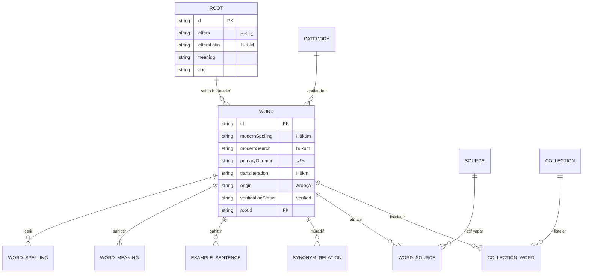

# LÜGAT — Osmanlı Türkçesi Dijital Sözlük ve Öğrenme Platformu

<div align="center">


[](https://nextjs.org/)
[](https://www.typescriptlang.org/)
[](https://tailwindcss.com/)
[](https://www.prisma.io/)
[](https://www.sqlite.org/)
[](https://github.com)
[](LICENSE)

*“Kelimelerin köklerine in, geçmişin dilini keşfet.”*

[Özellikler](#-öne-çıkan-özellikler) • [Tasarım Sistemi](#-tasarım-sistemi) • [Kök Gezgini](#-kök-gezgini-ve-i̇ştikak-şeceresi) • [API Dokümantasyonu](#-rest-api-mimarisi) • [Kurulum](#-kurulum-ve-çalıştırma) • [Katkı](#-katkı-sağlama)

</div>

---

## 📖 Proje Hakkında

**LÜGAT**, sıradan bir sözlük arama motoru veya statik tanıtım sitesi değildir. Modern Türkçe kelimeler ile Osmanlı Türkçesi kelime hazinesini, orijinal Arap harfli imlaları, iştikak köklerini (semantik ve morfolojik ağaçları), bâb ve vezin kaidelerini ve muteber lügat kaynaklarını birbirine bağlayan; tarihî lisan mirasımızı çağdaş yazılım mimarisiyle buluşturan **üretim ölçeğinde tam teşekküllü bir dijital platformdur**.

---

## 🌟 Öne Çıkan Özellikler

### 1. 🔍 Çift Alfabeli Akıllı Arama Motoru
- **Latin & Arap Harfli Çapraz Sorgulama**: Hem modern Türkçe (örn. *Eleştiri*), hem transkripsiyon (örn. *Tenḳīd*), hem orijinal Osmanlıca imla (örn. *تنقيد*) ve kök harfleri (örn. *حكم*) üzerinden anlık arama.
- **Gelişmiş Linguistik Normalizasyon**: 
  - Türkçe harf uyumu ve şapkalı karakter toleransı (`â, î, û, ḥ, ḳ, ṣ, ṭ, ẓ`).
  - Arap harflerinde fetha, kesra, damme, sükûn, tenvin ve şedde temizleme.
  - Elif/Ye/He varyantlarını (`أ, إ, آ, ى, ئ, ة`) normalize etme.
- **Sanal Osmanlıca Klavye**: Arap harfli klavyesi bulunmayan araştırmacılar için tek tıkla metin kutusuna harf ekleyen entegre sanal tuş takımı.

### 2. 🌳 Kök Gezgini (İştikak Şeceresi) — *Merkezi Sistem*
- Kelimeleri birbirinden kopuk alfabetik listeler yerine, müşterek üç veya dört harfli köklerinden doğan **morfolojik aile ağaçları** olarak sunar.
- **Örnek Kök**: `H-K-M (ح-ك-م)` → *Hüküm, Hâkim, Mahkeme, Mahkûm, Muhakeme, Hükûmet, Tahkim, İhkâm, Muhkem, Hikmet*.
- **Morfolojik Tasnif**: Türevler vezinlerine ve dilbilgisi rollerine göre görselleştirilir:
  - **İsm-i Fâil** (*Hâkim*)
  - **İsm-i Mef'ûl** (*Mahkûm*)
  - **İsm-i Mekân / Zaman** (*Mahkeme*)
  - **Masdarlar ve Bâblar** (*Tahkim - Tef'îl, Muhakeme - Mufâ'ale, İhkâm - İf'âl*)

### 3. 📜 Müstakil Kelime Sayfaları
- Yüksek çözünürlüklü hat tipografisi (Amiri font, RTL hizalama).
- Eşanlamlılar (Müradifler) ve aralarındaki **anlam nüansları** (*örn: Tenkid ile İntikad, Hüküm ile Kazâ farkı*).
- Klasik ve modern edebiyatımızdan edebi şahitler (*Namık Kemal, Ahmet Hamdi Tanpınar, Cenap Şahabettin, Yunus Emre*).
- Tarihî lügat kaynak referansları (*Kâmûs-ı Türkî, Lugat-ı Nâcî, Devellioğlu, Kubbealtı, Lehçe-i Osmânî*).

### 4. 🎓 Talimhane (Öğrenme Merkezi) & Aralıklı Tekrar (SRS)
- Çoktan seçmeli kelime sınavları.
- Orijinal Arap harfli imla okuma alıştırmaları.
- Kök ve vezin eşleştirme testleri.
- **Kişisel Kelimelik**: Öğrenilmek istenen kelimeleri tek tıkla kaydetme, `localStorage` ile senkronizasyon ve aralıklı tekrar algoritmasıyla gözden geçirme.

### 5. 📚 Tematik Koleksiyonlar ve Kategoriler
- 10 Temel Kategori: *Hukuk, Felsefe, Edebiyat, Tarih, Siyaset, Dinî Kavramlar, Bürokrasi, Tasavvuf, Bilim, Günlük Hayat*.
- Küratörlü Özel Koleksiyonlar (*Mecelle-i Ahkâm-ı Adliyye Terimleri, Divan Şiiri Mazmunları, Osmanlı Devlet Teşkilatı vb.*).

### 6. ⚙️ Yönetim Paneli (Admin)
- Kod yazmaya gerek kalmadan web arayüzünden yeni kelime, kök, türev, anlam ve kaynak ekleme.
- **Toplu İçe Aktarma (Batch Import)**: Yüzlerce kelimelik veri setlerini JSON veya CSV formatında tek işlemle veritabanına aktarma.
- Doğrulama statüsü yönetimi (*Kaynakla doğrulanmış, Editoryal açıklama, Yaklaşık karşılık, Doğrulama bekliyor*).

---

## 🎨 Tasarım Sistemi

LÜGAT, tarihî Osmanlı yazmaları ve hat sanatının zarafetini modern editöryel tasarım prensipleriyle birleştirir:

| Unsur | Değer / Kod | Kullanım Alanı |
| :--- | :--- | :--- |
| **Zemin (Parşömen)** | `#FDFBF7` / `#FAF7F2` | Gözü yormayan sıcak fildişi kâğıt dokusu |
| **Metin (Kömür)** | `#1C1917` / `#2C241E` | Yüksek kontrastlı, net okunabilir tipografi |
| **Birincil Vurgu (Bordo)** | `#8B1E1E` / `#6B1D2F` | Butonlar, başlık vurguları ve rozetler |
| **İkincil Vurgu (Mat Altın)** | `#C49A45` / `#C5A059` | Kök rozetleri, kenarlıklar ve özel simgeler |
| **Arapça Yazı Tipi** | `Amiri`, `Scheherazade New` | Otantik nesih ve rik'a karakter seti |
| **Latin Başlıklar** | `Playfair Display` | Klasik ve asil serif başlıklar |

---

## 🗄️ Veritabanı Şeması (Prisma ORM)



---

## 🔌 REST API Mimarisi

LÜGAT, harici uygulamalar ve entegrasyonlar için zengin bir REST API sunar:

| Uç Nokta (Endpoint) | Metot | Açıklama |
| :--- | :--- | :--- |
| `/api/search?q={sorgu}` | `GET` | Çift alfabeli (Latin/Arapça) ve kök tabanlı akıllı arama |
| `/api/roots` | `GET` | Tüm etimolojik kökleri ve türev sayılarını listeler |
| `/api/words/[slug]` | `GET` | Belirli bir kelimenin tüm detaylarını, kaynaklarını ve türevlerini döner |
| `/api/quiz` | `GET` | Talimhane modülü için dinamik soru havuzunu sunar |
| `/api/admin/words` | `POST` | Yeni kelime ve morfolojik ilişkileri veritabanına ekler |
| `/api/admin/import` | `POST` | JSON/CSV formatında toplu kelime aktarımı gerçekleştirir |

---

## 🚀 Kurulum ve Çalıştırma

### Gereksinimler
- **Node.js**: v18.18.0 veya üzeri (v20+ tavsiye edilir)
- **npm** veya **pnpm** / **yarn**

### 1. Depoyu Klonlayın
```bash
git clone https://github.com/KULLANICI_ADINIZ/lugat.git
cd lugat
```

### 2. Bağımlılıkları Yükleyin
```bash
npm install
```

### 3. Çevre Değişkenlerini Tanımlayın
```bash
cp .env.example .env
```

### 4. Veritabanını Oluşturun ve Verileri Yükleyin
```bash
# Prisma şemasını SQLite veritabanına uygulayın ve istemciyi derleyin
npx prisma db push
npx prisma generate

# 200+ doğrulanmış kelime, 60 kök, kaynaklar ve sınav sorularını yükleyin
node prisma/seed.js
```

### 5. Uygulamayı Başlatın
```bash
# Geliştirme (Development) Modu:
npm run dev

# veya Üretim (Production) Derlemesi:
npm run build
npm run start
```

Tarayıcınızda **`http://localhost:3000`** adresine gidin.

---

## 🧪 Test ve CI/CD

Proje, GitHub Actions üzerinde otomatik CI iş akışına sahiptir. Her push ve pull request işleminde:
- Kod sözdizimi ve TypeScript derleme doğrulaması,
- Prisma veritabanı şema ve tohumlama bütünlüğü,
- Üretim (`next build`) derleme testleri otomatik olarak icra edilir.

Yerel ortamda derlemeyi test etmek için:
```bash
npm run build
```

---

## 🤝 Katkı Sağlama

LÜGAT projesine katkıda bulunmak isteyen araştırmacıları, filologları ve yazılım mühendislerini aramızda görmekten mutluluk duyarız. Detaylı yönergeler için lütfen [CONTRIBUTING.md](CONTRIBUTING.md) belgesini inceleyiniz.

Katkı sürecinde tüm katılımcıların [Topluluk Kuralları Sözleşmesi](CODE_OF_CONDUCT.md)'ne uyması beklenmektedir.

---

## 📜 Lisans

Bu proje [MIT Lisansı](LICENSE) kapsamında açık kaynak olarak yayımlanmıştır. Kaynak gösterilerek serbestçe kullanılabilir, geliştirilebilir ve dağıtılabilir.
